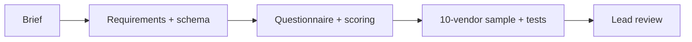

# 🔎 You are in Research and Risk Assessment

**16–18 November 2026 · deadline Wednesday 23:59 WAT**

**Start here:** read the [daily work plan](WORKPLAN.md), then the [project brief](../README.md). Use the [working tables](../templates/REQUIREMENTS_AND_TESTS.md). Report work using [submission rules](../governance/SUBMISSION_RULES.md).

**Put here:** `requirements_matrix.md`, `data_dictionary.md`, `workflow.md`, `demo_scenarios.md`, `criticality_method.md`, `question_bank.csv`, `risk_scoring_method.md`, `evidence_and_decision_rules.md`, `worked_examples.md`, `acceptance_cases.md`. Put connected fictional records in `../sample-data/` when that folder is created.

**Done means:** 10 vendors, 5 categories, 24+ responses each, every required edge case, explicit arithmetic/thresholds, evidence treatment, expected results and team-lead acceptance. Submit direct file links and commit SHA in the [handoff register](../governance/HANDOFFS.md).
