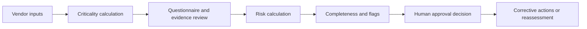

# Worked Research Examples

## 1. Purpose

These fictional examples show another GRC analyst how to reproduce the research specification's calculations for vendor criticality, questionnaire risk, evidence completeness, critical weaknesses, approval constraints, corrective-action status and material-change reassessment.

They apply the existing draft methods to the repository fixtures without changing the rules. They are research reference calculations, not a functioning toolkit or evidence of production approval. Methodology decisions and handoff acceptance remain subject to team-lead review and approval.

## 2. Source files

| File | Use |
|---|---|
| [vendor.csv](../sample-data/vendor.csv) | Current vendor factors and current assessment pointer |
| [assessment.csv](../sample-data/assessment.csv) | Assessment IDs, versions, dates, triggers and workflow status |
| [response.csv](../sample-data/response.csv) | Vendor claims, reviewer verification, verified answers and notes |
| [evidence_item.csv](../sample-data/evidence_item.csv) | Evidence IDs, states, review roles and validity dates |
| [decision.csv](../sample-data/decision.csv) | Recorded human outcomes, justifications, conditions and dates |
| [finding.csv](../sample-data/finding.csv) | Critical weaknesses and unresolved evidence findings |
| [corrective_action.csv](../sample-data/corrective_action.csv) | Action owners, deadlines and status |
| [change_event.csv](../sample-data/change_event.csv) | Material changes and reassessment links |
| [criticality_method.md](criticality_method.md) | Factor points, criticality bands and overrides |
| [risk_scoring_method.md](risk_scoring_method.md) | Weighted scoring, denominator, completeness and critical-failure rules |
| [evidence_and_decision_rules.md](evidence_and_decision_rules.md) | Evidence verification, decision constraints and overdue rules |
| [data_dictionary.md](data_dictionary.md) | Field meanings, relationships and allowed values |

Additional reproducibility sources are the canonical [question_bank.csv](question_bank.csv), its normalised [question.csv](../sample-data/question.csv), [business_service.csv](../sample-data/business_service.csv) and [vendor_service_link.csv](../sample-data/vendor_service_link.csv). Compare the arithmetic with [expected_question_scores.csv](../sample-data/expected_question_scores.csv), [expected_risk.csv](../sample-data/expected_risk.csv) and [expected_criticality.csv](../sample-data/expected_criticality.csv).

The fixture [README](../sample-data/README.md) fixes the report date at **18 November 2026 (WAT)**. Use that date for current evidence validity and overdue flags, rather than the date on which this document is read. Evaluate superseded ASMT-004 at its historical assessment date, **1 August 2026**. Its historical factor snapshot exists only in `expected_criticality.csv`; the current vendor row cannot reconstruct that earlier criticality. This is a documented research schema limitation, not a new source table.

## 3. Calculation conventions

### Criticality

Assign points from the four recorded factors:

| Factor | Value → points |
|---|---|
| Data sensitivity | None → 0; Internal → 1; Confidential → 2; Regulated → 3 |
| System access | None → 0; Standard → 1; Privileged → 2 |
| Dependency impact | 1 → 1; 2 → 2; 3 → 3; 4 → 4 |
| Replaceability | Easy → 1; Moderate → 2; Hard → 3; Very hard → 4 |

Add the four points. Scores 2–3 are Low, 4–6 Medium, 7–9 High and 10–13 Critical. Missing or invalid factors require resolution; they do not default to a favourable value.

Inspect every linked business service and use the highest service tier. A Business-critical service imposes a minimum High category. Regulated data together with Privileged access imposes Critical; dependency impact 4 together with Very hard replacement also imposes Critical. Record every applicable reason even if the base category already satisfies the override. Criticality describes business importance; it is separate from control risk and approval.

### Questionnaire arithmetic

Join response and evidence rows on `(assessment_id, question_id)` and join each question to its weight and answer-value mapping. A verified answer normally supplies a value from 0 (no identified weakness) to 4 (severe weakness or unresolved requirement). Multiply that assigned value by the question weight. A confirmed critical failure receives value 4 even when its answer's raw value is 3.

**Risk percentage = weighted risk points / maximum possible points × 100**

The denominator includes **every questionnaire question**, including unanswered or unverified questions. Each question contributes weight × 4 to the denominator. The current fixture denominator is **344**:

| Domain | Weights for questions 01, 02, 03, 04 | Weight sum | Maximum points |
|---|---|---:|---:|
| AM — Access management | 5, 3, 3, 4 | 15 | 60 |
| DP — Data protection | 5, 4, 3, 3 | 15 | 60 |
| IN — Incident notification | 5, 4, 3, 2 | 14 | 56 |
| BC — Continuity and recovery | 5, 4, 3, 3 | 15 | 60 |
| SC — Subcontractors | 5, 4, 3, 2 | 14 | 56 |
| GV — Governance | 4, 4, 2, 3 | 13 | 52 |
| Total: 24 questions | | 86 | 344 |

Keep integer numerators and the full denominator throughout. Round only the displayed percentage to six decimal places. Raw risk bands are Low below 20%, Medium from 20% to below 40%, High from 40% to below 60%, and Critical from 60% to 100%.

### Evidence, completeness and critical weaknesses

Every question in this fixture requires evidence. Count a question as answered when its vendor claim is not `Blank`. Count it as verified only when the response has `reviewer_verified = Yes`, a valid verified answer, a non-blank claim and Accepted evidence that has not expired at the applicable reference date.

| Evidence state | Verification and scoring treatment |
|---|---|
| Missing | No favourable verified credit; assign 4 |
| Received | Awaiting review; no favourable verified credit; assign 4 |
| Accepted and valid | Eligible for scoring from the reviewer-verified answer; acceptance can establish an adverse condition |
| Rejected | No favourable verified credit; assign 4 until replacement evidence is reviewed and accepted |
| Expired | No favourable verified credit; assign 4 until replacement evidence is reviewed and accepted |

An unreviewed response also receives 4, even if the vendor claim is favourable. Evidence is expired when its expiry date is earlier than the reference date; equality alone does not make it expired.

An assessment is Complete only when all 24 questions are answered and verified with valid Accepted evidence and no critical question is unresolved. Otherwise label it **Incomplete**, display the numeric percentage and raw band as **provisional**, and identify the gaps. Draft, Submitted and Superseded are stored workflow statuses, not calculated completeness labels.

Missing or unreviewed evidence on a critical question means **unresolved**, not proof of a failed control. A reviewer-confirmed failure on a critical question instead raises **Critical Failure**, assigns value 4 and makes the final rating at least High; an already Critical raw band stays Critical. The fixture applies this to verified critical answers with raw values 3 or 4. The unresolved policy question about other failure criteria remains in the [handoff draft](../governance/research_handoff_draft.md). A fully reviewed assessment may therefore be Complete and still have a confirmed critical failure and a High final rating.

### Human decisions, dates and history

A calculated rating does not create approval. Only an authorised human decision-maker records Approved, Conditionally Approved or Rejected, with justification and required dates. The decision-maker role must differ from the assessor role. Under the draft decision constraints, unresolved critical questions or confirmed critical failures prevent ordinary Approved outcomes; conditional approval requires a written exception, with a dated corrective action for a confirmed failure. No decision row means **Awaiting decision**.

An action is overdue when `due_date < report date` and its status is not Closed. Apply the same earlier-than comparison to a condition deadline, retaining the open-action state. Calendar days overdue are report date minus due date. A due date equal to the report date is not yet overdue. Review and approval expiry flags are separate from action status; expiry or later recalculation does not rewrite a recorded decision.

A material change creates a new assessment ID and version. Retain previous assessment inputs, responses, evidence, findings and decision snapshots; do not overwrite them with current values. The old assessment is marked Superseded, and `vendor.current_assessment_id` selects the new assessment for current reporting. Historical reporting uses the historical snapshot and its reference date. Updating the superseded marker does not replace the old assessment's substantive contents.

## 4. Visual workflow

## 5. Summary table

| Example | Vendor | Assessment | Criticality | Risk result | Completeness | Critical issue | Decision |
|---|---|---|---|---|---|---|---|
| 1 | VEN-001 NimbusCloud Hosting | ASMT-001 | 13 — Critical | 6/344 = 1.744186%; Low | Complete, 24/24 verified | None | Approved, DEC-001 |
| 2 | VEN-002 PayStream Processing | ASMT-002 | 12 — Critical | 59/344 = 17.151163%; provisional Low; final state Incomplete | Incomplete, 22/24 verified | AM-01 and DP-01 unresolved | Awaiting decision |
| 3 | VEN-003 SalaryBridge Payroll | ASMT-003 | 12 — Critical | 28/344 = 8.139535%; raw Low → final High | Complete, 24/24 verified | AM-01 confirmed failure; ACT-001 overdue | Conditionally Approved, DEC-002; condition overdue |
| 4 | VEN-009 LegalDocs Storage | ASMT-009 | 9 — High | 20/344 = 5.813953%; raw Low → final High | Complete, 24/24 verified | DP-01 confirmed failure | Rejected, DEC-008 |
| 5 — previous | VEN-004 SwiftPay Gateway | ASMT-004 | 9 — High | 3/344 = 0.872093%; historical Low | Complete, 24/24 verified; Superseded | None at historical snapshot | Approved, DEC-003; historical only |
| 5 — current | VEN-004 SwiftPay Gateway | ASMT-011 | 12 — Critical | 39/344 = 11.337209%; provisional Low; final state Incomplete | Incomplete, 23/24 verified | SC-01 unresolved; evidence Received | Awaiting decision |

## 6. Example 1 — Favourable complete assessment

**VEN-001 — NimbusCloud Hosting; ASMT-001.**

### Criticality

| Factor | Recorded value | Points |
|---|---|---:|
| Data sensitivity | Regulated | 3 |
| System access | Privileged | 2 |
| Dependency impact | 4 | 4 |
| Replaceability | Very hard | 4 |
| Total | 3 + 2 + 4 + 4 | 13 |

The base category is Critical (10–13). Linked services SVC-01 and SVC-03 are Business-critical, so the High floor applies. Regulated plus Privileged and dependency 4 plus Very hard also apply. All are already satisfied by the final **Critical** category.

### Risk, evidence and decision

The following table contains every non-zero contribution. The other 22 questions have valid Accepted evidence, verified value 0 and weighted points 0; they still contribute their maximum points to the denominator.

| Question | Reviewer-verified answer | Weight | Assigned value | Weighted points |
|---|---|---:|---:|---:|
| AM-02 | Twice yearly | 3 | 1 | 3 |
| IN-03 | Kept and monitored in business hours | 3 | 1 | 3 |
| Total | | | | 6 |

Risk percentage = **6/344 × 100 = 1.744186%**. The raw and final risk band is **Low**. There are 24 questions, 24 answered and **24/24 verified**, with all 24 evidence items Accepted and valid at the report date. There are no unresolved critical questions or confirmed critical failures. Calculated completeness is **Complete**; stored workflow status is Submitted.

DEC-001 records **Approved**, dated 1 September 2026, by **Head of Risk**, with justification “Strong verified controls”. Its review date is 1 December 2026 and expiry date 1 March 2027. The assessor role is GRC analyst. The favourable calculation informs this separate human decision; it does not generate the approval or replace the decision-maker's judgement.

## 7. Example 2 — Critical vendor with missing evidence

**VEN-002 — PayStream Processing; ASMT-002.**

### Criticality

| Factor | Recorded value | Points |
|---|---|---:|
| Data sensitivity | Regulated | 3 |
| System access | Privileged | 2 |
| Dependency impact | 4 | 4 |
| Replaceability | Hard | 3 |
| Total | 3 + 2 + 4 + 3 | 12 |

The base and final category is **Critical**. SVC-03 is Business-critical, imposing a High floor; Regulated plus Privileged also imposes Critical.

### Claims and missing evidence

| Question | Vendor claim | Reviewer verification / answer | Evidence | Assigned value and points |
|---|---|---|---|---|
| AM-01 | All privileged accounts | Not reviewed; verified answer empty | EV-025: Missing | 4 × weight 5 = 20 |
| DP-01 | All data at rest encrypted | Not reviewed; verified answer empty | EV-029: Missing | 4 × weight 5 = 20 |

Both claims correspond to favourable answer options, but neither has reviewer-verified support. The missing evidence therefore contributes **40 risk points**, not zero, and both questions remain in the denominator. FND-001 and FND-002 are Open findings for these gaps. They establish unresolved critical questions, not confirmed failures of MFA or encryption.

Every non-zero contribution is shown below; the other 16 questions have verified value 0 and weighted points 0.

| Question | Verified answer or unresolved requirement | Weight | Assigned value | Weighted points |
|---|---|---:|---:|---:|
| AM-01 | Missing evidence; unverified | 5 | 4 | 20 |
| AM-02 | Twice yearly | 3 | 1 | 3 |
| AM-03 | Within 1 business day, manual | 3 | 1 | 3 |
| DP-01 | Missing evidence; unverified | 5 | 4 | 20 |
| IN-03 | Kept and monitored in business hours | 3 | 1 | 3 |
| IN-04 | Incident, notified on time, lessons recorded | 2 | 1 | 2 |
| SC-04 | Documented, untested | 2 | 2 | 4 |
| GV-03 | 80 to 94 percent | 2 | 2 | 4 |
| Total | 20 + 3 + 3 + 20 + 3 + 2 + 4 + 4 | | | 59 |

Risk percentage = **59/344 × 100 = 17.151163%**. Its raw band is provisional Low. There are **24/24 answered**, **22/24 verified**, 22 valid Accepted evidence items and two Missing items. Completeness and final displayed state are **Incomplete**; workflow status is Draft. The unresolved critical questions are **AM-01 and DP-01**.

There is no decision row for ASMT-002, so its status is **Awaiting decision**. A low provisional percentage must not produce favourable approval automatically. The draft decision constraints prevent an ordinary Approved outcome while these critical questions remain unresolved; conditional approval would require a documented human exception. Neither vendor claims nor the numeric percentage resolve the evidence gaps.

## 8. Example 3 — Confirmed critical weakness and overdue action

**VEN-003 — SalaryBridge Payroll; ASMT-003; DEC-002; ACT-001.**

### Criticality and confirmed failure

| Factor | Recorded value | Points |
|---|---|---:|
| Data sensitivity | Regulated | 3 |
| System access | Standard | 1 |
| Dependency impact | 4 | 4 |
| Replaceability | Very hard | 4 |
| Total | 3 + 1 + 4 + 4 | 12 |

The base and final category is **Critical**. Payroll service SVC-02 is Business-critical, and dependency 4 plus Very hard replacement also imposes Critical. The Regulated-plus-Privileged override does not apply because recorded system access is Standard. That business access factor does not remove the separately evidenced privileged-account MFA weakness.

For AM-01 the vendor claims “All privileged accounts”, but the reviewer verifies **“Some privileged accounts”**, supported by **Accepted EV-049**, valid until 29 November 2026. The reviewer note confirms that adverse answer. Its answer-option value is **3**. Because AM-01 is a critical-failure question and the failure is confirmed, assign **4**, producing **5 × 4 = 20** weighted points rather than 5 × 3 = 15. This accounts for the five-point difference that would arise if the critical-failure scoring rule were omitted.

| Question | Reviewer-verified answer | Weight | Assigned value | Weighted points |
|---|---|---:|---:|---:|
| AM-01 | Some privileged accounts; confirmed critical failure | 5 | 4 | 20 |
| AM-02 | Twice yearly | 3 | 1 | 3 |
| IN-03 | Kept and monitored in business hours | 3 | 1 | 3 |
| IN-04 | Incident, notified on time, lessons recorded | 2 | 1 | 2 |
| Total | 20 + 3 + 3 + 2 | | | 28 |

The other 20 questions have verified value 0. Risk percentage = **28/344 × 100 = 8.139535%**. The raw band is Low, but confirmed **AM-01 Critical Failure** makes the final risk rating **High**. There are **24/24 answered** and **24/24 verified** questions, with 24 valid Accepted evidence items, so completeness is **Complete**. FND-003 remains Open. Complete describes the review, not control effectiveness or permission to proceed.

### Conditional decision and overdue action

DEC-002 records **Conditionally Approved** by **Head of Risk** on 1 September 2026, separately from the GRC analyst's assessment. The recorded written justification is:

> Written exception: payroll continuity with time-limited MFA remediation; restricted access and monitoring

Its condition is **“Enforce privileged MFA”**, with condition deadline and review date **31 October 2026**, and decision expiry **1 March 2027**. This is a recorded exception to the ordinary approval constraint for a confirmed critical failure, not an approval created by the calculation.

ACT-001 links to FND-003 and VEN-003. Its action is **“Enforce MFA for every privileged account”**, responsible party **Vendor security lead**, due **31 October 2026**. Stored status is **Open**, with no closed date.

At the fixture report date, 31 October 2026 < 18 November 2026 and the action is not Closed. Days overdue = **18 November 2026 − 31 October 2026 = 18 calendar days**. Therefore ACT-001 and the linked condition are **overdue**. The decision remains a historical Conditionally Approved record with an overdue condition; the calculated High rating neither creates that decision nor makes the missed condition acceptable. The review date is also overdue, while the decision expiry has not yet passed at this reference date.

## 9. Example 4 — Strong aggregate score overridden by critical failure

**VEN-009 — LegalDocs Storage; ASMT-009; DEC-008.**

### Criticality

| Factor | Recorded value | Points |
|---|---|---:|
| Data sensitivity | Regulated | 3 |
| System access | Standard | 1 |
| Dependency impact | 3 | 3 |
| Replaceability | Moderate | 2 |
| Total | 3 + 1 + 3 + 2 | 9 |

The base and final category is **High** (7–9). SVC-08 is Important, so no Business-critical floor applies. Standard access and dependency 3 mean neither Critical override applies.

### Accepted adverse evidence and risk override

All 23 questions other than DP-01 have valid Accepted evidence and verified value **0**, including every AM, IN, BC, SC and GV question and DP-02 to DP-04. These strong answers contribute zero risk points but remain in the denominator.

For DP-01 the claim is **“All data at rest encrypted”**, while the verified answer is **“Not encrypted”** (value 4). **EV-197** is Accepted, reviewed by Security reviewer, received 10 November 2026 and valid until 1 February 2027. Its fictional reference is `evidence/ASMT-009/DP-01.txt`; this is a fixture reference, not a supplied evidence file. The reviewer note confirms “Not encrypted”, and Open Critical finding **FND-006** records “Accepted configuration proves regulated data not encrypted”. Acceptance establishes the adverse condition; it does not award a passing control result.

| Question | Weight | Assigned value | Weighted points | Maximum points |
|---|---:|---:|---:|---:|
| DP-01 | 5 | 4 | 20 | 20 |
| Other 23 questions combined | 81 | 0 each | 0 | 324 |
| Total | 86 | | 20 | 344 |

Risk percentage = **20/344 × 100 = 5.813953%**. The raw band is **Low**. There are **24/24 answered** and **24/24 verified** questions with valid Accepted evidence: completeness is **Complete**. However, DP-01 is a **confirmed critical failure**, so the final risk rating is **High**. A low aggregate percentage cannot conceal the critical encryption weakness by averaging it against unrelated strong controls.

DEC-008 records **Rejected**, dated 10 November 2026, by **Head of Risk**, with justification **“Confirmed DP-01 encryption failure; do not onboard”**. Its recorded review and expiry dates are 18 May 2027. The human rejection is a separate decision based on the finding and rating; the percentage does not itself create any approval or rejection.

## 10. Example 5 — Material-change reassessment

**VEN-004 — SwiftPay Gateway; previous ASMT-004; current ASMT-011; CHG-001 and CHG-002.**

Both change events are dated **15 September 2026**, have `material = Yes` and point to ASMT-011: **CHG-001 — New subcontractor** and **CHG-002 — Access increase**. Version 2 was created on 16 September 2026 with trigger Material change and `supersedes_id = ASMT-004`. The current vendor pointer is ASMT-011.

### Before-and-after comparison

| Field | Previous version | Current version |
|---|---|---|
| Assessment ID | ASMT-004 | ASMT-011 |
| Version number | 1 | 2 |
| Assessment date | 1 August 2026 | 16 September 2026 |
| Assessment trigger | Initial | Material change |
| Calculation reference date | 1 August 2026, historical snapshot | 18 November 2026, fixture report date |
| Data sensitivity | Regulated → 3 | Regulated → 3 |
| System access | Standard → 1 | Privileged → 2 |
| Dependency impact | 3 → 3 | 4 → 4 |
| Replaceability | Moderate → 2 | Hard → 3 |
| Criticality score | 3 + 1 + 3 + 2 = 9 | 3 + 2 + 4 + 3 = 12 |
| Criticality band | High | Critical |
| Answered count | 24/24 | 24/24 |
| Verified count | 24/24 | 23/24 |
| Risk numerator | 3 | 39 |
| Denominator | 344 | 344 |
| Risk percentage | 0.872093% | 11.337209%, provisional |
| Risk band / final state | Historical Low | Provisional raw Low / Incomplete |
| Completeness | Complete at historical snapshot | Incomplete |
| Evidence status | 24 Accepted and valid at historical reference date | 23 Accepted and valid; SC-01 Received |
| Superseded status | Yes; stored status Superseded | No; stored status Draft |
| Current decision status | DEC-003 Approved retained as historical only; does not approve current scope | Awaiting decision; no decision row for ASMT-011 |

SVC-03 is Business-critical in both versions, imposing a High floor. The old base category is already High. The new base category is Critical, also required by Regulated plus Privileged. Historical factors come from the preserved ASMT-004 row in `expected_criticality.csv`; substituting current `vendor.csv` factors would incorrectly change the old score from 9 to 12.

### Questionnaire arithmetic and evidence awaiting review

The table lists every non-zero contribution for either version. All other questions have verified value 0 in both versions and remain in the denominator.

| Question | Weight | Previous assigned value | Previous points | Current verified answer or requirement | Current assigned value | Current points |
|---|---:|---:|---:|---|---:|---:|
| AM-02 | 3 | 1 | 3 | Twice yearly | 1 | 3 |
| AM-03 | 3 | 0 | 0 | Within 1 business day, manual | 1 | 3 |
| IN-03 | 3 | 0 | 0 | Kept and monitored in business hours | 1 | 3 |
| IN-04 | 2 | 0 | 0 | Incident, notified on time, lessons recorded | 1 | 2 |
| SC-01 | 5 | 0 | 0 | Received evidence awaiting review | 4 | 20 |
| SC-04 | 2 | 0 | 0 | Documented, untested | 2 | 4 |
| GV-03 | 2 | 0 | 0 | 80 to 94 percent | 2 | 4 |
| Total | | | 3 | 3 + 3 + 3 + 2 + 20 + 4 + 4 | | 39 |

Previous risk percentage = **3/344 × 100 = 0.872093%**. Current risk percentage = **39/344 × 100 = 11.337209%**. The additional 36 points comprise 20 from unresolved SC-01 and 16 from other changed verified answers; the change records identify reassessment triggers, not a causal explanation for each answer change.

For current **SC-01**, the vendor claims **“Complete list and prior notice”**, but `reviewer_verified = Not reviewed`, `verified_answer` is empty and the note is **“Review pending”**. **EV-257** has status **Received**, received 16 September 2026, with no reviewer role or expiry date yet. Receipt alone cannot earn favourable verified credit: assign **5 × 4 = 20** and flag SC-01 as an **unresolved critical question**. There is no confirmed critical failure in this assessment; its final displayed state is Incomplete rather than a completed Low rating.

Open finding **FND-007** records the new subcontractor register awaiting review. **ACT-004** assigns Security reviewer to “Review new subcontractor register and notification clause”, due 15 December 2026, status Open. At 18 November 2026 it is not overdue.

### Preserved history and current decision

DEC-003 records **Approved** for ASMT-004 on 1 August 2026, by Head of Risk, justified as **“Prior scope and verified controls”**, with review date 1 December 2026 and expiry 1 February 2027. Retain it against version 1; its unexpired date does not extend approval to the new scope. ASMT-011 has no decision row, so current decision status is **Awaiting decision**.

A material change creates a new assessment version. Previous substantive assessment records remain unchanged, with the prior assessment marked Superseded; previous decisions remain historical records. Current reporting follows `vendor.current_assessment_id = ASMT-011`. Historical reporting selects ASMT-004 and its own factor, response, evidence and decision snapshot. For example, historical AM-01 evidence EV-073 expires on 30 October 2026: it was valid at 1 August 2026, so later expiry must not retroactively alter that historical calculation.

## 11. Reconciliation and handoff limits

All six assessment calculations used in these five examples match the repository reference numerators, denominator, six-decimal percentages, verification counts, criticality categories and completeness states. No fixture correction is required. The raw-versus-assigned AM-01 value in Example 3 and the historical-versus-current factors in Example 5 explain the apparent differences an analyst would obtain by omitting the relevant rules.

The [fixture validator](../sample-data/validate_fixture.py) verifies research fixtures and expected calculations only. Run `python sample-data/validate_fixture.py` from the repository root, or `python3 sample-data/validate_fixture.py` where the Python interpreter is named `python3`. Existing policy decisions, specific methodology citations, historical-schema treatment, independent analyst review and formal acceptance remain recorded in the [research handoff draft](../governance/research_handoff_draft.md) and [handoff register](../governance/HANDOFFS.md).

Research artefacts are complete for handoff only after team-lead review and approval. Toolkit Development has not been started.
