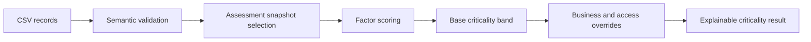

# Phase 2 status — validation completion and criticality engine

Status: **PASS — Phase 2 scope verified locally**

Phase 2 implements semantic validation and vendor criticality calculation only.
Risk scoring, evidence scoring, decisions, remediation, management reporting and
the Streamlit interface remain later-phase work. No commit or push was made.

Repository: `third-party-cyber-risk-vendor-assurance-toolkit`

Branch: `main`

Starting commit: `00eb6ee`

Ending commit: `00eb6ee` (changes remain uncommitted)

## Objective

Extend the Phase 1 CSV foundation with cross-table semantic validation,
assessment-level historical criticality snapshots, an explainable criticality
engine, terminal commands and deterministic CSV/JSON/Markdown outputs. Preserve
the Phase 1 loader, commands, structural checks and tests.

## Files created

- `sample-data/assessment_criticality_snapshot.csv`
- `src/criticality.py`
- `tests/test_criticality.py`
- `tests/test_criticality_boundaries.py`
- `tests/test_semantic_validation.py`
- `reports/phase2/criticality_results.csv`
- `reports/phase2/criticality_results.json`
- `reports/phase2/criticality_results.md`
- `reports/phase2/semantic_validation_report.json`
- `reports/phase2/semantic_validation_report.md`

## Files modified

- `src/config.py`
- `src/schema.py`
- `src/loader.py`
- `src/validation.py`
- `src/cli.py`
- `src/README.md`
- `sample-data/README.md`
- `reports/README.md`

## Semantic validation

Phase 2 retains Phase 1 structural checks and adds validation for current
assessment ownership/status, reassessment versions and triggers, material-change
links and dates, service links and tiers, questionnaire coverage and options,
evidence fields and audit history, decision independence and conditions,
corrective-action ownership/status/overdue dates, and historical snapshot
relationships and factor values. Duplicate and orphaned records remain visible
as errors; no duplicate winner is selected. For report date 2026-11-18, the
approved fixture passes with zero errors and one overdue open action (ACT-001).

## Historical snapshot approach

The new snapshot CSV stores all 11 assessment versions explicitly. Current
assessment snapshots match their vendor register factors. ASMT-004 stores its
historical `Regulated / Standard / 3 / Moderate` factors and is never recomputed
from current VEN-004 values. ASMT-011 has its own current snapshot. The expected
output file is read only after calculation for an explicit comparison; it does
not supply runtime factors.

## Criticality formula, thresholds and overrides

```text
Criticality score = data sensitivity + system access + dependency impact + replaceability
```

| Total points | Base band |
|---:|---|
| 2–3 | Low |
| 4–6 | Medium |
| 7–9 | High |
| 10–13 | Critical |

Overrides are applied after the base band:

1. Business-critical service support sets a floor of High.
2. Regulated data combined with Privileged access sets Critical.
3. Dependency impact 4 combined with Very hard replacement sets Critical.

Every result includes its inputs, points, linked services, highest service tier,
override reasons, errors and a readable calculation trace. Missing or invalid
factors never become zero; incomplete results use
`PROVISIONAL — INCOMPLETE INPUTS` and do not publish a final category.



## CLI commands

The Phase 1 `inventory` and `validate` commands remain available. Phase 2 adds:

```sh
python -m src.cli semantic-validate --data-dir sample-data --as-of 2026-11-18
python -m src.cli criticality
python -m src.cli criticality --assessment-id ASMT-001
python -m src.cli criticality --vendor-id VEN-004
python -m src.cli criticality --all
python -m src.cli criticality --all --as-of 2026-11-18
```

All commands read CSVs only. Criticality results sort by assessment ID and
source CSV files are never modified. Invalid inputs return a non-zero status.
Use `python3` in environments without a `python` executable.

## Verification

| Check | Result |
|---|---|
| Unit tests | PASS — 55 tests, including the preserved Phase 1 suite |
| Criticality boundaries | PASS — exact scores 2, 3, 4, 6, 7, 9, 10 and 13 |
| Override tests | PASS — all three overrides and multiple-service highest tier |
| Historical snapshots | PASS — ASMT-004 = 9 High; ASMT-011 = 12 Critical |
| Expected criticality comparison | PASS — 11 of 11 assessments, including override reasons |
| Research fixture validator | PASS — run separately from the toolkit CLI |
| Semantic validation fixture | PASS — 13 source tables, zero errors at report date 2026-11-18 |
| Phase 1 regression tests | PASS — existing loader, validation and smoke tests |
| CLI commands | PASS — inventory, Phase 1 validate, semantic-validate, criticality all, assessment and vendor filters |
| Generated reports and whitespace check | PASS — all five Phase 2 reports exist; `git diff --check` is clean |
| SQLite / source mutation | PASS — no SQLite use; source CSVs remain read-only |

## Limitations and next phase

CSV files and audit entries cannot recreate a prior file state that was never
preserved. Evidence items are checked against immutable IDs and required audit
events; replacement evidence must use a distinct ID and retained assessment
version. Existing composite-key audit target ambiguity remains unresolved.
Service links are optional when the source records no supported service; every
present link is validated and all valid linked tiers are considered.

Phase 2 does not implement risk scoring, evidence scoring, decisions, remediation,
management reports or GUI. Recommended next phase: **Phase 3 — Questionnaire,
Evidence and Risk-Scoring Engine**.
