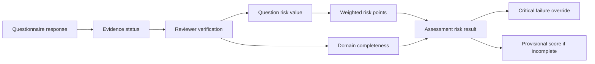

# Phase 3 — Questionnaire, evidence and risk scoring

Phase 3 processes the approved 24 questions and links each claim and reviewer
answer to its assessment and evidence. It produces question scores, domain
completeness and assessment ratings with calculation explanations.

## Files created

- `src/risk_scoring.py` and `src/risk_reports.py`
- `tests/test_risk_scoring.py`, `tests/test_evidence_rules.py`,
  `tests/test_domain_completeness.py` and `tests/test_risk_fixture_comparison.py`
- `reports/phase3/question_scores.csv` and `reports/phase3/question_scores.json`
- `reports/phase3/domain_completeness.csv` and `reports/phase3/domain_completeness.json`
- `reports/phase3/risk_results.csv`, `reports/phase3/risk_results.json` and `reports/phase3/risk_results.md`
- This status document

## Method

Each question contributes its assigned value times its weight. The denominator
is four times the sum of all question weights, or 344 for this fixture.
Unrounded percentages determine bands at 20%, 40% and 60%.

Accepted evidence needs reviewer information and an expiry date on or after the
evaluation date. Superseded assessments use their own assessment date. A
reviewer verified answer that improves the vendor claim needs a reviewer note.
Unanswered or unverified questions receive 4 and stay in the denominator.
Domain completeness is the verified count divided by the domain question count.

A verified value of 3 or 4 on a critical question receives 4 and sets a High
floor for completed ratings. An unresolved critical question makes its
assessment Incomplete. Incomplete assessments show a provisional percentage.



## Commands

```sh
python -m src.cli risk
python -m src.cli risk --assessment-id ASMT-001
python -m src.cli risk --vendor-id VEN-002
python -m src.cli risk --all --as-of 2026-11-18
python -m src.cli question-scores --assessment-id ASMT-009
```

Use `--reports-dir` for separate filtered exports. Fixture comparisons use all
assessments at the fixture report date.

## Verification

The fixture comparison matched 11 assessment results, 264 question scores
and 66 domain rows. All 68 unit tests passed, including the Phase 1 and Phase 2
regression suites. The research fixture validator, inventory, structural
validation, semantic validation, criticality, risk and question score commands
passed. Earlier phase CLI checks wrote reports to temporary directories.

## Limitations and next phase

The engine evaluates recorded reviewer judgments. Evidence artifacts are outside
the supplied CSV data. Approval decisions, corrective actions, reassessment
workflow, management reporting, Streamlit GUI and deployment remain later phases.

Phase 4 — Decisions, Remediation, Reassessment and Management Reporting.
