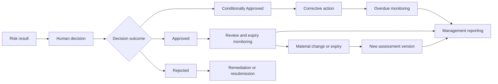

# Phase 4 — Decisions, remediation, reassessment and management reporting

Phase 4 validates human decision records and reports corrective actions,
reassessment triggers, assessment history and current vendor totals.

## Rules

- Current records follow the vendor's explicit current assessment ID.
  Superseded records and their decisions remain available in history.
- The recorded decision-time rating, current calculated rating and recorded
  outcome are separate fields. Ordinary approval fails for critical failures
  or incomplete items. Conditional decisions require dated actions linked
  through findings, including coverage of each unresolved item. Critical
  exceptions require written justification.
- Expiry and overdue flags use a strict earlier-than comparison. A rejected
  decision is excluded from approvals. Open conditions use linked action
  closure as the available indicator because the CSV has no condition status.
- Changes, differences between the register and current assessment factors,
  expired approvals, overdue vendor reviews and expired critical evidence
  surface reassessment triggers. Linked changes retain their existing assessment IDs.
- Management counts distinct current vendors. Open finding totals use distinct
  finding IDs. Concentration lists every service and vendor with its linked IDs.
  A count mismatch or fixture mismatch fails the command.
- The fixture's VEN-006 approval predates evidence expiry. The report preserves
  its decision snapshot and flags the expiry while showing the current risk result.



## CLI and outputs

```sh
python -m src.cli decisions --as-of 2026-11-18
python -m src.cli remediation --as-of 2026-11-18
python -m src.cli reassess --vendor-id VEN-004
python -m src.cli management-report --as-of 2026-11-18
python -m src.cli vendor-report --vendor-id VEN-009
```

The default report date is 2026-11-18. The default output directory is
`reports/phase4`. Decision, remediation, reassessment and management summaries
have CSV, JSON and Markdown forms. Reconciliation and concentration have CSV
exports. Individual Markdown reports appear in `reports/phase4/vendors`.
Omit the vendor filter to produce all vendor reports.

## Verification and reconciliation

All 77 unit tests and the research fixture validator passed. The earlier
inventory, validation, criticality and risk commands also passed. Their
verification runs used temporary report destinations.

The management fixture matches all 33 breakdown and vendor-ID rows.
The report contains 10 current vendors, seven open findings across six
vendors, two open conditions and three unexpired Approved outcomes.
VEN-004 retains ASMT-004 with DEC-003 and selects ASMT-011 with Awaiting decision.

## Limitations and next phase

The CSV records contain role names and written decisions. They lack independent
proof of approval authority and condition closure. The available history is
limited to recorded versions and evidence states. Reports use the vendor
register's current pointer even with a different report date.

Phase 5 — Streamlit GUI and User Interaction. Streamlit GUI and deployment remain
for later phases.
