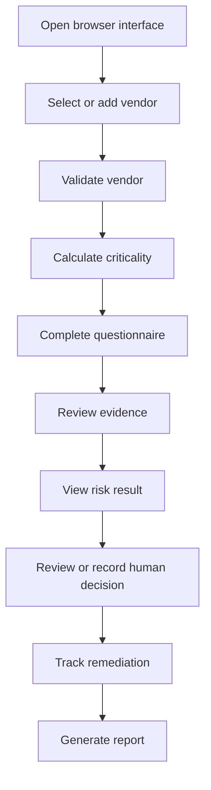

# Phase 5 — Streamlit GUI and user interaction

The local browser interface uses the existing Python engines for validation,
criticality, risk, human decision checks, remediation and operational reporting.



## Run locally

```sh
python -m pip install -r app/requirements.txt
streamlit run app/streamlit_app.py
python -m unittest discover -s tests -v
python3 sample-data/validate_fixture.py
```

See the [user guide](../app/README.md) for the virtual environment setup and the
page-by-page instructions. Use `--reports-dir` on CLI report commands to
preserve previous generated reports.

## Verification

The report date is 2026-11-18 by default. CLI checks cover inventory, structural
and semantic validation, criticality, risk, decisions, remediation, management
reporting and the VEN-004 comparison. Source CSV checksums verify fixture integrity.

The 91 unit tests passed with Python 3.12 and Streamlit 1.67.0, including all
Phase 1–4 regression tests and GUI tests for the nine pages. The independent
research fixture validator passed. Streamlit started locally and its health
endpoint responded. Chrome rendered the dashboard at 800 pixels and the vendor
register at 1366 pixels, and downloaded a CSV containing the VEN-001 record.
No commit or push was made.

## Phase 5 scope

The app holds a working copy per session and exports changes as CSV downloads
and report packages. The source CSVs stay unchanged. The browser interface uses
fictional data only, including for public demonstrations. SQLite is unused.
Deployment and production access control remain for a later phase.

Phase 6 — End-to-End QA, Deployment Preparation and Final Documentation.
