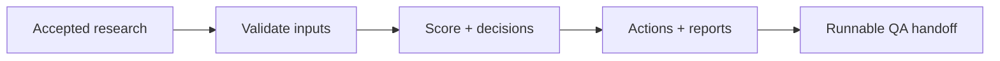

# 🛠️ You are in Toolkit Development

**19–23 November 2026 · deadline Monday 23:59 WAT**

Read the [five-day work plan](WORKPLAN.md), [research handoff](../governance/HANDOFFS.md) and [submission rules](../governance/SUBMISSION_RULES.md). Confirm the approved schema and example calculations before implementing. Choose a reproducible workbook or script; web hosting is optional.

**Put here:** build notes, design decisions and status. Put runnable code in `../src/` or workbook in `../workbook/`; fictional inputs in `../sample-data/`, outputs in `../reports/examples/`, tests in `../tests/`, guide in `../docs/`. Create each directory when first needed with its own README.

**Done means:** clean-run instructions, connected 10-vendor data, validated inputs, explainable scores and flags, human decisions, actions/history, reports and a tested commit. Submit file links, exact run command, example outputs and gaps to QA.
