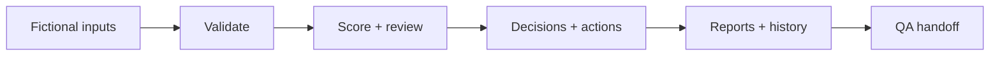

# 🛠️ Toolkit Development — 5 days

**Window:** Thursday 19 to Monday 23 November 2026, **23:59 WAT**. Start from the accepted research specification. See [folder guide](README.md), [submission rules](../governance/SUBMISSION_RULES.md), and [handoff register](../governance/HANDOFFS.md).

## Thursday 19 — choose build and validate inputs

1. Read the accepted data dictionary, methodology and acceptance cases. Resolve any ambiguity with Research and record the decision.
2. Select Python, Excel, or another reproducible approach. Record the reason, supported versions and exact commands/opening steps.
3. Build connected vendor and business-service records with immutable vendor IDs and assessment version IDs.
4. Reject duplicate IDs, missing required fields, invalid options/dates and orphan references with row/field-specific errors. Keep valid data intact.

**Show by end of day:** ten fictional vendors import; criticality runs; invalid records produce clear errors.

## Friday 20 — questionnaire, evidence and scoring

1. Import the complete question bank and all 10×24+ responses.
2. Preserve separate vendor claim, reviewer finding, evidence state, review date, expiry and rejection reason.
3. Implement the accepted criticality and risk formulas, completeness, score explanation and critical-weakness override. Missing/unverified evidence cannot become a verified favourable result.
4. Make a report showing inputs, arithmetic, flagged gaps and source IDs for a favourable, adverse and incomplete case.

**Show:** reproducible results matching Research's worked examples.

## Saturday 21 — decisions, actions and history

1. Add Approved, Conditionally Approved and Rejected decision records with authorised reviewer, reason, conditions, deadline and review/expiry dates.
2. Add weaknesses, corrective actions, owner, deadline and status. Flag overdue actions and conditions.
3. Trigger reassessment on material service/access/dependency change. Preserve the previous assessment and show before/after values.
4. Flag overdue reviews and expired approvals; keep calculated recommendation separate from human decision.

**Show:** all three decision outcomes and a reassessment comparison.

## Sunday 22 — management reporting and integration

1. Generate individual vendor reports and a consolidated management report.
2. Show critical suppliers, unresolved weaknesses, overdue reviews/actions, outstanding conditions and concentration across business services.
3. Reconcile every count to distinct underlying IDs; a vendor linked to three services still counts as one vendor.
4. Run the ten demo actions in the main README and record failures with owners.

**Show:** report totals with source-ID lists and demo evidence.

## Monday 23 — packaging and QA handoff

1. Fix integration failures; run focused calculation, validation and history tests.
2. Supply source/workbook, fictional input files, dependency list, user guide, sample outputs and exact run instructions.
3. Document restricted storage for real files, reviewer permissions, evidence references and version retention. Public GitHub holds fictional data only.
4. Identify the tested commit as `dev-candidate-v1`. Complete the [handoff record](../governance/HANDOFFS.md) and give QA a clean-run walkthrough by **23:59 WAT**.

## Strict acceptance

QA can reproduce the entire demo from a clean download; every required component works; ten vendors and all answers process; missing evidence and critical weaknesses stay visible; final decisions identify a human reviewer; old versions survive; invalid inputs are rejected; and report totals reconcile. List any uncompleted item, severity, owner and due date. A file link and commit are required for submission.

**Target layout:** `src/` or `workbook/`, `sample-data/`, `tests/`, `reports/examples/`, `docs/USER_GUIDE.md`. The implementation choice is made after research sign-off.
