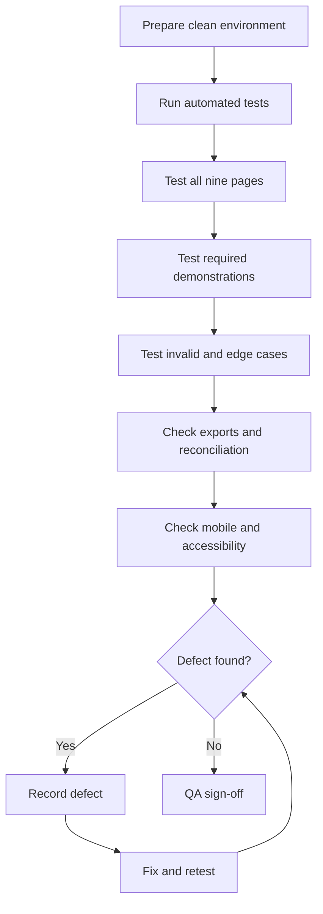

# Testing and Quality Assurance

**27 November–1 December 2026, inclusive. Deadline 1 December 2026, 23:59 WAT (UTC+1).**

Group 3 coordinates coverage, assignment, defect triage and independent QA review. Every project member is encouraged to test and report observations. Testers record what they observe on the candidate commit and link evidence for every PASS.

1. Choose cases and an independent reviewer in the [workplan](WORKPLAN.md).
2. Follow the [test execution guide](TEST_EXECUTION_GUIDE.md). Copy the [test case template](TEST_CASE_TEMPLATE.md) for each run and use the [defect report template](DEFECT_REPORT_TEMPLATE.md) when a check fails.
3. Record a new version-specific run and link it from the QA handoff. Keep prior test, defect, retest and sign-off records intact.
4. Deliver the completed register, defect register, retest evidence and independent recommendation to Group 4 and the team lead. If access is missing, follow the [upload guide](../UPLOAD_GUIDE.md).

Release requires zero unresolved Critical or High defects, documented reviewer acceptance of Medium defects, retesting of every correction and sign-off that identifies the tested commit. Every handoff includes the **file path, commit SHA, test result, reviewer, acceptance status and known limitations**.

## Project links

- [GitHub repository](https://github.com/ayuba-amadi/third-party-cyber-risk-vendor-assurance-toolkit) · [Live Streamlit application](https://icdfa-vendor-assurance-toolkit.streamlit.app)
- [User guide](../docs/user_guide.md) · [Project documentation](../docs/project_documentation.md) · [Deployment guide](../docs/deployment_guide.md)
- [Test register](../tests/TEST_REGISTER.md) · [Defect register](../tests/DEFECT_REGISTER.md) · [QA sign-off](../tests/QA_SIGNOFF.md)
- [Acceptance matrix](../reports/phase6/final_acceptance_matrix.md) · [Management reconciliation](../reports/phase6/reconciliation_report.md)
- [Presentation outline](../docs/presentation_outline.md) · [Demonstration script](../docs/demonstration_script.md)
- [Contribution record](../governance/FINAL_CONTRIBUTIONS.md) · [Submission rules](../governance/SUBMISSION_RULES.md)
