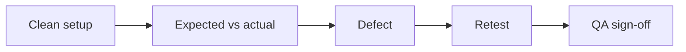

# 🧪 You are in Testing and Quality Assurance

**Upload blocked?** Read the [upload and access guide](../UPLOAD_GUIDE.md); an unaccepted invitation or missing collaborator access prevents direct upload. A fork and pull request works while access is arranged.

**24–27 November 2026 · deadline Friday 23:59 WAT**

Read the [four-day work plan](WORKPLAN.md), accepted [research cases](../01-research-and-risk-assessment/WORKPLAN.md), [submission rules](../governance/SUBMISSION_RULES.md) and the actual build guide. Test independently; do not substitute a developer assertion for an observed result.

**Put here:** QA coordination and case ownership. Put `TEST_REGISTER.md`, `DEFECT_REGISTER.md`, `QA_SIGNOFF.md` and synthetic fixtures in `../tests/` when created, with a README there.

**Done means:** ten demo actions run, all required edge cases checked, expected and actual recorded, fixes retested, report totals reconciled and unresolved defects disclosed. Submit tested commit and evidence links.
