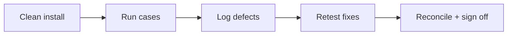

# 🧪 Testing and Quality Assurance — 4 days

**Window:** Tuesday 24 to Friday 27 November 2026, **23:59 WAT**. Test the development candidate independently. Start at [folder guide](README.md) and follow [submission rules](../governance/SUBMISSION_RULES.md).

## Tuesday 24 — independent setup and data checks

1. Download a clean copy; follow only the supplied guide. Record versions, commands, actual results and setup defects.
2. Confirm 10 unique vendors, five categories, three critical services and every questionnaire row.
3. Check duplicate IDs, missing values, bad dates/options and orphan links. Independently calculate sample criticality classifications.

**Output:** `tests/TEST_REGISTER.md` started with requirement ID, input, expected, actual, pass/fail, evidence, defect and retest columns.

## Wednesday 25 — evidence, scoring and approvals

1. Exercise Missing, Received, Accepted, Rejected and Expired evidence; distinguish claim from reviewer verification.
2. Prove a critical failure cannot be hidden by favourable unrelated answers.
3. Verify the three decision outcomes, human reviewer and justification; score alone cannot grant approval.
4. Test overdue conditions/actions, expired approval and overdue review.

**Output:** reproducible test cases, screenshots/output paths and defect entries.

## Thursday 26 — change, history and reporting

1. Change access/dependency and verify criticality and reasons change.
2. Reassess after material service change; confirm previous assessment remains readable.
3. Reconcile management counts to distinct vendor, action and condition IDs. Verify multi-service concentration without double-counting vendors.
4. Retest fixed defects against the original reproduction steps.

**Output:** `tests/DEFECT_REGISTER.md` and reconciled report evidence.

## Friday 27 — full demo and release gate

1. Run all ten live demo actions in main README from a clean state.
2. Record expected, actual, correction, retest and evidence for every case. Do not mark an unrun case Pass.
3. Publish `tests/QA_SIGNOFF.md`: tested commit, environment, pass/fail totals, unresolved defects with severity, limitations, reviewer and date.
4. Hand the tested version to Documentation and team lead by **23:59 WAT**.

## Strict acceptance

No open Blocker or High defect in ID integrity, criticality, evidence treatment, critical flags, decision authority, history or report totals. Any unmet demo action is visible in sign-off with owner and correction date. QA submits file links, tested commit and a completed [handoff entry](../governance/HANDOFFS.md). Severity: Blocker (cannot use), High (misleading assurance), Medium (workflow impaired), Low (cosmetic).
