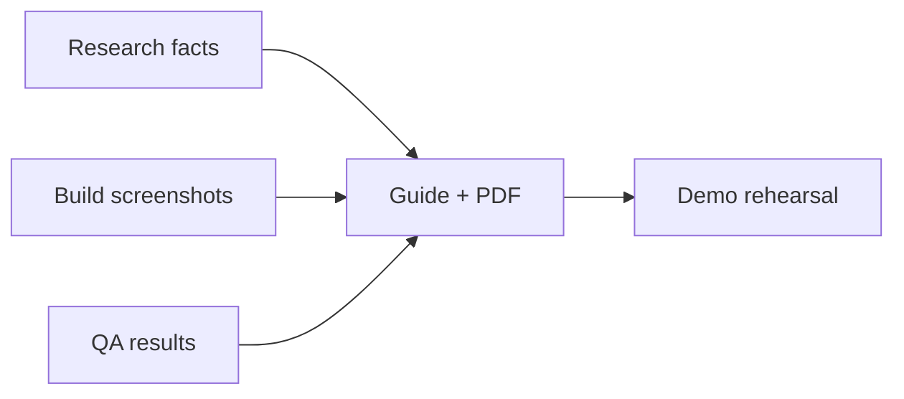

# 📝 You are in Documentation and Presentation

**Upload blocked?** Read the [upload and access guide](../UPLOAD_GUIDE.md); an unaccepted invitation or missing collaborator access prevents direct upload. A fork and pull request works while access is arranged.

**16–29 November 2026 · final package Sunday 23:59 WAT**

Read the [daily guide](WORKPLAN.md), [project brief](../README.md) and [submission rules](../governance/SUBMISSION_RULES.md). Work alongside other groups, then replace drafts with the tested release's real screenshots and results.

**Put here:** coordination notes and storyboard. Put the abstract, PDF, user guide, slides/script and labelled screenshots in `../docs/` when created, with a README there.

**Done means:** 200–300-word abstract; PDF with required sections and screenshots; reproducible guide; all ten actions rehearsed; accessible download link; test corrections and limitations; complete contributions. Submit tested version and exact file links.
