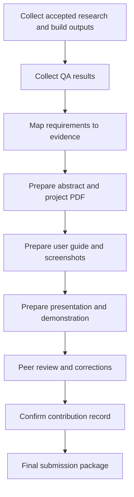

# Documentation and Presentation

**2–5 December 2026, inclusive. Final internal deadline 5 December 2026, 23:59 WAT (UTC+1).** The official E-Campus deadline takes precedence.

Group 4 assembles the final package from accepted research, the tested toolkit and the independent QA handoff. Follow the [daily workplan](WORKPLAN.md) and use the [documentation index](../docs/README.md) to find the editable sources and existing artifacts.

Download the official template from E-Campus. Use that template and align the PDF and approximately 200–300-word abstract with the official requirements. Do not invent or substitute an unofficial template. Use screenshots and results from the tested commit only. Identify its SHA in the submission package.

Include requirements mapping, toolkit design, scoring rules, workflow diagrams, testing and defect results, screenshots, limitations, operating instructions, deployment and rollback, accessible GitHub and live-toolkit links, presentation slides, demonstration script, contribution record and final submission checklist.

Record only verified contributions as completed. List only members who actually contributed and keep evidence for each contribution. Every handoff includes the **file path, commit SHA, test result, reviewer, acceptance status and known limitations**. Follow the [upload guide](../UPLOAD_GUIDE.md) if repository access is missing.

## Project links

- [GitHub repository](https://github.com/ayuba-amadi/third-party-cyber-risk-vendor-assurance-toolkit) · [Live Streamlit application](https://icdfa-vendor-assurance-toolkit.streamlit.app)
- [User guide](../docs/user_guide.md) · [Project documentation](../docs/project_documentation.md) · [Deployment guide](../docs/deployment_guide.md)
- [Test register](../tests/TEST_REGISTER.md) · [Defect register](../tests/DEFECT_REGISTER.md) · [QA sign-off](../tests/QA_SIGNOFF.md)
- [Acceptance matrix](../reports/phase6/final_acceptance_matrix.md) · [Management reconciliation](../reports/phase6/reconciliation_report.md)
- [Presentation outline](../docs/presentation_outline.md) · [Demonstration script](../docs/demonstration_script.md)
- [Contribution record](../governance/FINAL_CONTRIBUTIONS.md) · [Submission rules](../governance/SUBMISSION_RULES.md)
