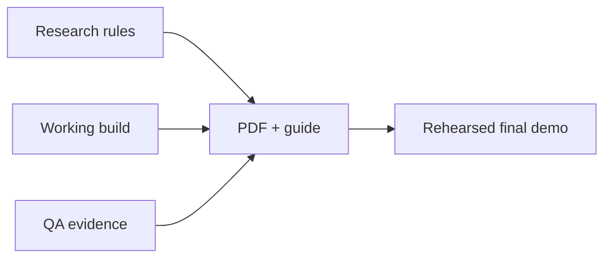

# 📝 Documentation and Presentation — continuous, 16–29 November

**Final integrated target:** Sunday 29 November 2026, **23:59 WAT**. Work alongside Research, Development and QA. Use [folder guide](README.md) and [submission rules](../governance/SUBMISSION_RULES.md). Confirm the official E-Campus deadline separately.

## 16–18 Nov — structure and research content

1. Outline the PDF: 200–300 word abstract; problem/objectives; requirements; architecture and data model; scoring; evidence and decision workflows; testing; limitations; storage/access/versioning; operating steps.
2. Draft the user-guide steps and slide/demo storyboard. Link each of the ten live demonstration actions in the root README to an operator, input, expected screen and screenshot to capture.
3. Copy only accepted research rules into the PDF. Record sources and decisions. Mark absent build screenshots as pending.

**Output:** `docs/PROJECT_OUTLINE.md`, draft abstract, guide outline and demo storyboard.

## 19–23 Nov — document the running toolkit

1. Follow the implementation each day. Write exact setup, inputs, version requirements, commands or workbook instructions and output paths.
2. Capture actual screenshots using fictional data with a caption, tested build version and scenario ID. Explain formulas and report fields in plain language.
3. Explain how real assessment files would be stored with restricted access, who records reviewer decisions, and how previous versions are retained.
4. Draft an individual assessment narrative and management report explanation from generated outputs.

**Output:** draft `docs/USER_GUIDE.md`, PDF draft and screenshot inventory.

## 24–27 Nov — align to QA evidence

1. Replace draft numbers and screenshots with the QA-tested version. Include expected/actual test results, fixes, retests and limitations.
2. Check each management total against QA's source-ID reconciliation.
3. Finish slides/script for all ten actions, assigning presenter, operator, timing, exact input, expected output and fallback screenshot.

**Output:** review-ready PDF, abstract and demo deck/script linked to tested commit.

## 28–29 Nov — final review and rehearsal

1. Deliver `docs/PROJECT_DOCUMENTATION.pdf`, `docs/USER_GUIDE.md`, the 200–300-word E-Campus abstract, deck/script, accessible implementation link and complete contribution record.
2. Run a full rehearsal from a clean download. Confirm all links, screenshots, fictional labels and reports match QA sign-off.
3. Submit file links and final commit/version in [handoff register](../governance/HANDOFFS.md). Obtain team-lead review by **29 Nov, 23:59 WAT**.

## Strict acceptance

A new GRC analyst can follow the guide and reproduce the demo. The PDF contains every E-Campus section and real screenshots; scoring claims match implementation; totals reconcile; limitations are honest; abstract is 200–300 words; all members have contribution entries. State any missing item and owner explicitly.
