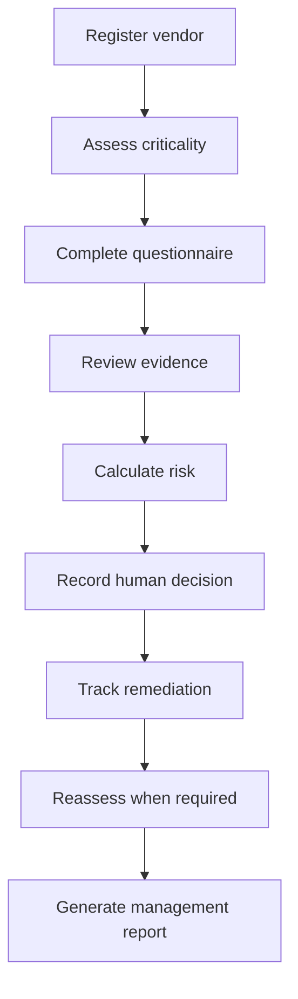
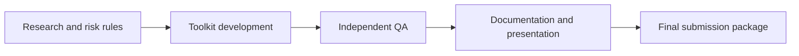

# Third-Party Cyber Risk Assessment and Vendor Assurance Toolkit

This ICDFA Certified GRC Engineering capstone gives teams a repeatable way to assess fictional suppliers, explain cyber risk results, record human decisions and track corrective actions. The toolkit brings the vendor register, questionnaire, evidence review, reassessment history, and management reporting into one Streamlit application.

## Problem being addressed

Supplier assurance often spans several spreadsheets and email threads. That makes it hard to tell which claims were verified, why a supplier received a rating, who accepted the risk, and whether actions are overdue. The toolkit links those steps by record ID so a reviewer can trace a management total back to the supplier, assessment or action behind it.

## Toolkit users

| User | What to do here |
|---|---|
| GRC analyst | Register suppliers, assess criticality, review evidence and track follow-up. |
| Data protection officer | Review data access, sensitive information and evidence gaps. |
| QA tester | Run the regression suite, independently reproduce scenarios and record evidence. |
| Developer | Run the Python engine and Streamlit interface, then verify changes against the fixtures. |
| Presenter | Rehearse the ten required demonstrations with the fictional baseline. |
| Supervisor or public visitor | Review the methodology, tested results, limitations and contribution record. |

## Key capabilities

- Register vendors and link them to business services. Classify criticality using data sensitivity, access, dependency and replaceability.
- Assess 24 questionnaire items per assessment and distinguish supplier claims from verified answers. Track Missing, Received, Accepted, Rejected and Expired evidence.
- Calculate risk and completeness with reasons. Keep confirmed critical failures visible even when unrelated answers score well.
- Record Approved, Conditionally Approved or Rejected outcomes with an explicit human decision. Track findings, owners, due dates and closure.
- Compare assessment versions and report material changes. Generate individual and portfolio reports, including overdue items and concentration, with source IDs for reconciliation.

## Technology stack

Python 3.12 is the documented local environment. Streamlit provides the browser interface, and Python modules provide validation, calculations and a command-line interface. CSV files supply the fictional inputs. Regression tests use `unittest` and Streamlit's app test utilities. Reports support CSV, JSON, Markdown and HTML downloads.

## Live application

- [Open the fictional-data Streamlit demo](https://icdfa-vendor-assurance-toolkit.streamlit.app)

## GitHub repository

- [Browse source, commit history and issues on GitHub](https://github.com/ayuba-amadi/third-party-cyber-risk-vendor-assurance-toolkit)

## Quick start

Install Git and Python 3.12. Run these commands in a Bash-compatible shell. If `.venv` already exists, start with activation after entering the repository.

```bash
git clone https://github.com/ayuba-amadi/third-party-cyber-risk-vendor-assurance-toolkit.git
cd third-party-cyber-risk-vendor-assurance-toolkit
python3.12 -m venv .venv
source .venv/bin/activate
python -m pip install -r requirements.txt
python -m streamlit run app/streamlit_app.py --server.headless true --server.port 8501
```

Open `http://localhost:8501`. Use the sidebar report date **18 November 2026** to reproduce the baseline. Use **Reset session** before switching to another independent scenario. Stop Streamlit with Ctrl+C. [User guide](docs/user_guide.md)

## Project architecture

The loader reads bundled CSVs, and validation checks required values, allowed options and relationships. The Streamlit workspace keeps session-local edits in a working copy. The Python engine calculates criticality, risk, remediation and reassessment results from validated inputs. Reporting combines those outputs with recorded human decisions. The CLI can regenerate fixture-based checks and reports independently of the interface. [Project documentation](docs/project_documentation.md) · [Engine and CLI guide](src/README.md)

## Repository structure

| Path | Contents |
|---|---|
| [app/](app/) | Streamlit entry point, nine pages, session state and exports |
| [src/](src/) | Validation, risk engine, workflows and CLI |
| [sample-data/](sample-data/) | Fictional source tables, invalid cases and expected results |
| [tests/](tests/) | Automated tests and recorded QA evidence |
| [reports/](reports/) | Generated reports and historical verification evidence |
| [docs/](docs/) | User, deployment and final submission materials |
| [01-research-and-risk-assessment/](01-research-and-risk-assessment/) · [02-toolkit-development/](02-toolkit-development/) | Research specifications and build records |
| [03-testing-and-quality-assurance/](03-testing-and-quality-assurance/) · [04-documentation-and-presentation/](04-documentation-and-presentation/) | Current QA and finalisation workplans |
| [governance/](governance/) · [templates/](templates/) | Submission rules, handoffs, contributions and working templates |

## End-to-end workflow



The demonstration follows this path using the baseline of ten fictional vendors, five categories and eleven assessment versions. Rehearse new vendor entry, access or dependency change, missing evidence, critical failure, an individual report, conditional approval, overdue and expired records, material-change reassessment, invalid input rejection and management reconciliation. The script provides fixture IDs for the live workflow. [Demonstration script](docs/demonstration_script.md) · [Presentation outline](docs/presentation_outline.md)

## Current QA and documentation schedule

| Workstream | Dates | Required result |
|---|---|---|
| Testing and Quality Assurance | 27 Nov–1 Dec 2026 | Completed test register, defect register, retest evidence and QA recommendation |
| Documentation and Presentation | 2–5 Dec 2026 | Final PDF, abstract, user guide, presentation, demo script, screenshots and contribution record |
| Internal final package | 5 Dec 2026, 23:59 WAT | Version-matched final submission package |

QA closes on **1 December 2026 at 23:59 WAT**. WAT is UTC+1. The **official E-Campus deadline takes precedence** over the internal target. Check E-Campus for the official template, requirements and submission deadline.



## Testing instructions

Run the checks from the repository root in a clean QA checkout. The management-report command writes generated files under `reports/phase4/`. Keep the original checkout and historical evidence intact.

```bash
source .venv/bin/activate
./.venv/bin/python -m unittest discover -s tests -v
./.venv/bin/python sample-data/validate_fixture.py
./.venv/bin/python -m src.cli management-report --as-of 2026-11-18
git diff --check
```

Group 3 coordinates testing. Every project member is encouraged to test and report observations. Record evidence before marking a case PASS. Run all nine pages and the ten demonstrations, review downloads and reconcile the totals. The linked QA records describe the revisions identified in those files. Record fresh results for the release candidate. [Testing index](tests/README.md) · [Test execution guide](03-testing-and-quality-assurance/TEST_EXECUTION_GUIDE.md) · [Test register](tests/TEST_REGISTER.md) · [QA sign-off](tests/QA_SIGNOFF.md)

## Reporting defects

Use the defect template with the tested commit, fictional record IDs, exact steps, expected and actual results, impact and evidence. Log the defect and link it to the case. Retest each correction. Release requires no unresolved Critical or High defects, documented acceptance of Medium defects and sign-off against the tested commit. [Defect report template](03-testing-and-quality-assurance/DEFECT_REPORT_TEMPLATE.md) · [Defect register](tests/DEFECT_REGISTER.md)

## Contribution rules

Agree on a named owner and reviewer. Use a descriptive commit and the assigned project directory. Contributors without write access can submit a pull request from a fork or work with the nominated uploader. Each handoff includes the **file path, commit SHA, test result, reviewer, acceptance status and known limitations**. Record completed contributions only when supported by evidence and list only people who contributed. [Upload guide](UPLOAD_GUIDE.md) · [Submission rules](governance/SUBMISSION_RULES.md) · [Handoff register](governance/HANDOFFS.md) · [Final contribution record](governance/FINAL_CONTRIBUTIONS.md)

## Fictional-data and privacy controls

Use fictional names, records and evidence references in GitHub, the hosted demo, screenshots, exports and defect reports. Keep credentials, tokens, personal information and real vendor evidence out of all public materials. Session edits stay in the working copy. Download any fictional work you need before resetting the session. Use an access-restricted organisational system for real supplier records.

## Deployment and rollback overview

Use Streamlit Community Cloud with the reviewed revision and `app/streamlit_app.py` as the entry point. Verify the health endpoint, page loads, exports and fictional-data baseline after deployment. Record the deployed commit. If a release fails, redeploy a branch at the last verified commit or revert the release through review, then repeat the smoke checks. [Deployment and rollback guide](docs/deployment_guide.md)

## Limitations

The toolkit is a fictional-data demonstration with session-local edits, user-entered role names and metadata-only evidence references. It does not enforce production identity or access controls. Creating a new reassessment version requires controlled CSV entry, and historical reconstruction is limited to retained inputs. Team-defined scoring supports reviewer judgement. It carries no certification or compliance determination.

## Expected deliverables

- Working toolkit with vendor register, completed questionnaires, scoring method, evidence and action registers, three decision outcomes, and individual and consolidated reports. [Project documentation](docs/project_documentation.md)
- Completed tests, defects, retests and independent QA recommendation linked to the tested commit. [Final acceptance matrix](reports/phase6/final_acceptance_matrix.md) · [Management reconciliation](reports/phase6/reconciliation_report.md)
- A 200–300-word abstract, project PDF, requirements mapping, user guide, deployment and rollback instructions, tested screenshots, slides, demo script, verified contribution record and submission checklist. Download the official E-Campus template and align the PDF and abstract with its requirements. [Abstract](docs/abstract.md) · [Project PDF](docs/project_documentation.pdf) · [Documentation workplan](04-documentation-and-presentation/WORKPLAN.md)

## Official design references

- [NIST SP 800-161 Rev. 1 Update 1 — Cybersecurity Supply Chain Risk Management](https://csrc.nist.gov/pubs/sp/800/161/r1/upd1/final)
- [NIST SP 1305 — CSF 2.0 supply chain quick-start guide](https://csrc.nist.gov/pubs/sp/1305/final)
- [NIST Cybersecurity Framework 2.0](https://www.nist.gov/publications/nist-cybersecurity-framework-csf-20)
- [NIST SP 800-53 Rev. 5 — Security and Privacy Controls](https://csrc.nist.gov/pubs/sp/800/53/r5/upd1/final)
- [Toolkit scoring method](01-research-and-risk-assessment/risk_scoring_method.md) · [Worked research examples](01-research-and-risk-assessment/worked_examples.md)
