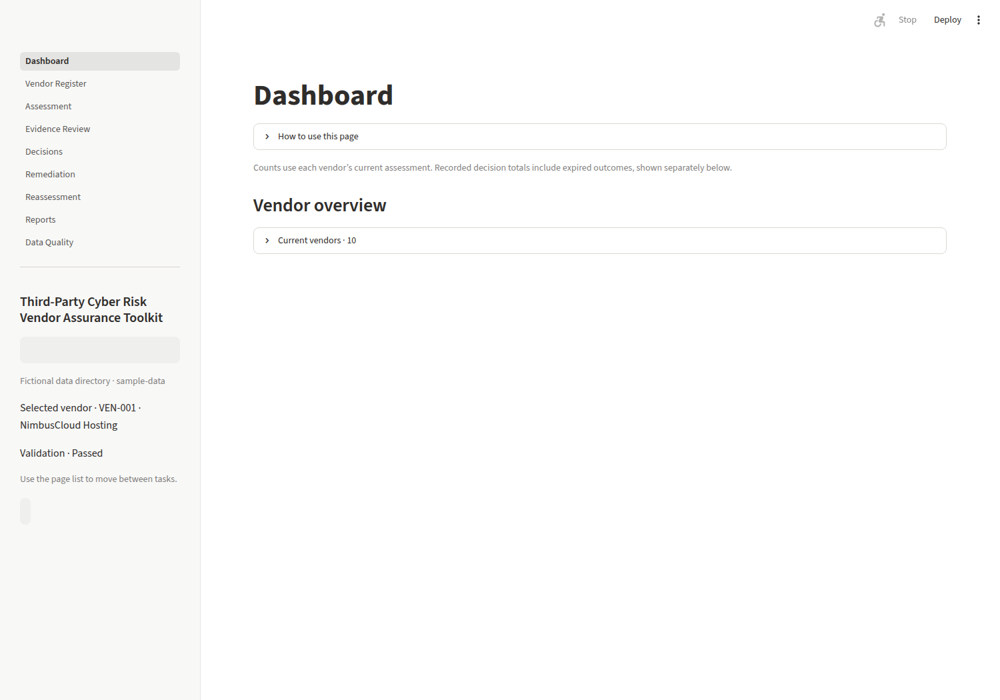
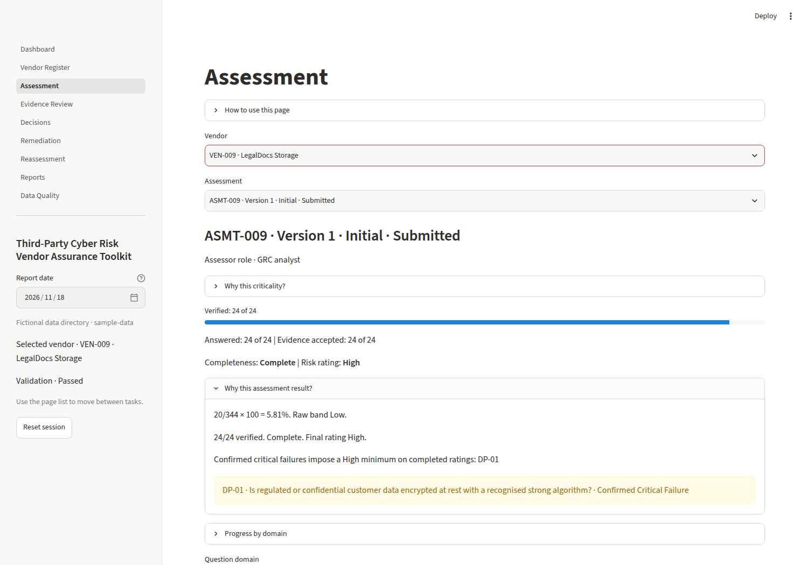
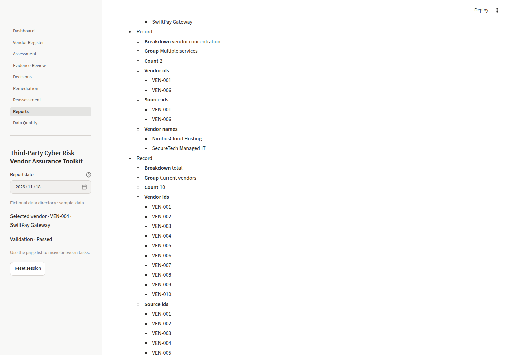

# Third-party cyber-risk and vendor-assurance toolkit

## 1. Abstract

Organisations rely on suppliers to process data, run important services and support daily operations. Supplier failures can interrupt those services or expose sensitive information. When teams use different questionnaires, accept unsupported claims or record decisions in separate files, they can miss weaknesses and struggle to explain their conclusions to management.

This project provides a third-party cyber-risk and vendor-assurance toolkit for governance, risk and compliance analysts, data protection officers, reviewers and authorised approvers. A Python calculation and validation layer serves a command-line interface and a Streamlit application. Linked CSV tables represent fictional vendors, business services, assessments, responses, evidence metadata, findings, decisions, corrective actions and change history.

The toolkit assigns vendor criticality using data sensitivity, access, business dependency and replaceability. Its risk calculation applies weights and severity values to questionnaire results. It checks reviewer evidence status and applies adverse scoring when required evidence is missing or unsuitable. A confirmed critical weakness can raise the final rating even when other controls perform well. A human records the approval decision separately. Individual and management reports trace results to source records and use a selected reporting date to identify overdue and expired items.

The demonstration uses ten fictional vendors across five categories. It covers missing evidence, a confirmed encryption failure, conditional approval, an overdue action and reassessment following material change. The toolkit shows how consistent inputs and decision records can support review and oversight. The demonstration uses session-only edits, unauthenticated fictional roles and evidence metadata without underlying documents. It is suitable for assessment and training with fictional data. Production use would require independently governed access, evidence storage, policy approval and operational controls.

## 2. Problem statement

Suppliers can interrupt important services or handle sensitive data. Inconsistent questionnaires, unsupported claims and informal decision records make those risks hard to compare and trace.

## 3. Project objectives

Standardise fictional intake, assess criticality and control risk, record reviewer judgements and authorised decisions, follow corrective work and produce traceable reports.

## 4. Requirements mapping

The acceptance matrix maps R01–R08, D01–D08, Q01–Q10 and the submission deliverables to source files, implementation and executed checks. See `reports/phase6/final_acceptance_matrix.md` and `tests/TEST_REGISTER.md`.

## 5. System architecture

CSV fixtures feed Python loaders and validation. The calculation and workflow modules serve both `src.cli` and `app/streamlit_app.py`. Streamlit stores edits in a session workspace. CLI reports can be rebuilt locally. Neither calculation path needs network access.

## 6. CSV data model

Vendor IDs connect the register to service links and assessments. Assessment IDs connect responses, evidence, findings and decisions. Question IDs link a response to the question bank. Actions link to findings. Change events and criticality snapshots provide version context. Reviewer audit entries link changes to record IDs.

## 7. Vendor register

The register uses one row per vendor with category, data handling, access, dependency, replaceability, owner role and review status. Service links allow a vendor to support multiple services.

## 8. Criticality methodology

The engine adds points for data sensitivity, system access, dependency and replaceability, then applies the thresholds and overrides in `01-research-and-risk-assessment/criticality_method.md`. The score, factors and reasons are available for review.

## 9. Questionnaire design

The bank contains 24 questions over six control domains. Responses bind an answer and its metadata to an assessment and question. Partial response sets remain visible.

## 10. Evidence assessment

A reviewer examines the claim and records evidence status. Accepted, current evidence can verify the response. Missing, unreviewed, rejected and expired evidence earns adverse scoring. The fixture stores references only.

## 11. Risk scoring

The engine uses weighted severity and a documented denominator. A confirmed critical failure imposes a minimum final rating. Completeness is based on verification. An incomplete result retains the calculation trail and affected question IDs.

## 12. Decision workflow

The calculated result belongs to the engine. Verification belongs to the reviewer. An authorised human enters the decision, justification and dates. Conditional decisions include conditions, a deadline and linked corrective work. Management reporting aggregates dated records.

## 13. Remediation tracking

Findings link to corrective actions with responsible parties, due dates and status. Open actions are overdue when their due date precedes the report date. Review completion evidence before recording closure.

## 14. Reassessment and version history

Material events trigger review. VEN-004 provides ASMT-004 and ASMT-011 with preserved assessment and decision history. Use the linked changes and before-and-after factor and risk calculations.

## 15. Management reporting

Reports count unique vendors and group them by category, criticality and decision. Additional rows expose incomplete assessments, critical failures, overdue items, open findings and conditions, and concentration. Source IDs and dated rules support reconciliation.

## 16. User interface

The nine pages cover Dashboard, Vendor Register, Assessment, Evidence Review, Decisions, Remediation, Reassessment, Reports and Data Quality. The sidebar selects the report date, shows validation and resets the session.

## 17. Validation rules

Required fields, identifiers, allowed values, date syntax and ordering, and cross-table relationships are checked. Errors describe the affected records and proposed corrections. Session candidates are checked before save.

## 18. Testing

The Phase 6 package records baseline and final commands, controlled-copy reproduction, source hashes, GUI checks, defects and observed demonstration results. See `tests/QA_SIGNOFF.md` and `reports/phase6/qa_summary.md`.

## 19. Screenshot references

The local browser capture set covers all eleven required states. See `docs/screenshots/README.md` for the full gallery and `reports/phase6/evidence/browser.txt` for the executed browser steps.

{width=85%}

{width=85%}

{width=85%}

## 20. Limitations

Application roles are inputs. The toolkit has no production authentication, durable shared record store or real evidence repository. Historic reports depend on available records and snapshots. Independent acceptance is pending.

## 21. Operating instructions

Install the root requirements, start Streamlit from the repository root and use 18 November 2026 for the standard fixture. Follow `docs/user_guide.md` and `docs/operating_model.md`.

## 22. Deployment preparation

The root Streamlit settings disable telemetry and select headless mode. The deployment guide covers GitHub connection, entry point, verification and rollback. Live deployment was not executed.

## 23. Data storage and access restrictions

The app reads its bundled data directory and keeps editing in memory. CSV and Markdown exports are explicitly downloaded. Keep all hosted and local demonstration records fictional.

## 24. Version retention

Retain IDs and version links. Export the relevant session records and reports before reset. Preserve prior decisions with the assessment on which they were made.

## 25. Fictional-data controls

Use the bundled fictional dataset, invented people and controlled evidence references. Use the source hash check after testing.

## 26. Contribution record

The contribution register retains evidence-backed research and identifies entries that still require verification. See `governance/FINAL_CONTRIBUTIONS.md`.

## 27. Toolkit access instructions

Run `streamlit run app/streamlit_app.py --server.headless true --server.port 8501` and open the local URL. See `docs/deployment_guide.md` for a future hosted deployment.
