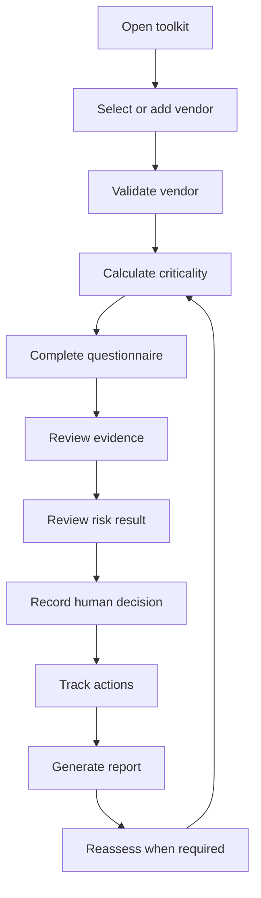

# User guide

The toolkit helps GRC analysts, data protection officers, vendor-risk reviewers, approvers and managers assess supplier risk. Use the bundled fictional records and fictional additions.

## Start and choose a date

From the repository root, run `python -m pip install -r requirements.txt` and `streamlit run app/streamlit_app.py --server.headless true --server.port 8501`. Open the local URL printed in the terminal. Pick **Report date** in the sidebar. Use 18 November 2026 to reproduce the capstone examples. Date changes recalculate overdue and expiry flags.

## Record a vendor and run an assessment

1. Open **Vendor Register**. Search by ID or name, or filter by category, criticality or status. Under **Add vendor**, enter a unique ID such as VEN-011, name, category, data types, sensitivity, access, dependency impact, replaceability, owner role, status, review date and change flag. Use **Validate vendor**, then **Calculate criticality** to see the factor points, band and any override. Use **Save vendor to session** to retain the row while working.
2. Open **Assessment** and choose the vendor and assessment. Create a draft where offered. Select each question, enter the answer and note and save the response. Check completeness across domains.
3. Open **Evidence Review**. Choose the question and check the claim, evidence status, review dates and reviewer notes. Record only fictional evidence references. An Accepted record can support verification when it satisfies the review rules. Missing, unreviewed, rejected and expired evidence earns adverse treatment.
4. Return to **Assessment** for the weighted risk calculation. Read provisional results with the completeness flag. Review question IDs and any confirmed failure and override before making a decision.

## Record decisions and follow up

1. Open **Remediation** to review findings and record or update linked corrective actions. Record an owner, due date and status. Compare due dates with the selected report date.
2. Open **Decisions** for a current assessment awaiting a decision. Enter the fictional authorised role and name, outcome, rationale and required dates. For conditional approval, enter conditions and a deadline and select a linked action with a responsible party. Preview the decision, then explicitly confirm it. Existing decisions appear in the historical or current records.
3. Use **Reassessment** to inspect change events and compare versions. For a new reassessment, prepare a separate controlled copy of the fictional CSVs. Add a new assessment and criticality snapshot, link the old assessment and change events, and update the vendor’s current assessment ID. Preserve the earlier assessment and its decision. Run semantic validation on that copy before reviewing the new result and seeking a fresh human decision.

## Reports, errors and reset

Open **Reports** and choose the management summary or a vendor and assessment. Check dates, source IDs, completeness and decision status. Use each download control to save the available Markdown or CSV file. Open CSV in a spreadsheet as text and retain the original identifiers.

Use **Data Quality** to run validation. Correct the file, row and field shown in an error message. Use the accepted choices and ISO dates (`YYYY-MM-DD`). Review warning details before continuing. Download any session records you need, then use **Reset session** to reload the original fictional fixtures.

The application keeps session edits in memory. It cannot authenticate an approver, inspect real evidence documents, persist shared records or grant approval on its own.
