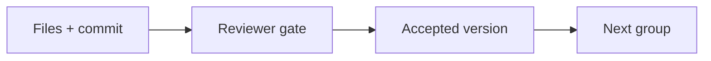

# 📋 You are in Governance and Handoffs

This folder is the project's review record. Start with [how to submit](SUBMISSION_RULES.md), then update [phase handoffs](HANDOFFS.md) and [member contributions](CONTRIBUTIONS.md).

Every phase row needs version/commit, submitted by, checked by, decision and gaps with owner/date. Record real work for every member with file or issue evidence. The team lead confirms membership and acceptance; pending is not approval. Do not include student IDs or personal emails in public files.
| Foka Averil | Research and Risk Assessment | Day 1 (17 Nov 2026) | Created requirements_matrix.md (R01-R08, D01-D08, Q01-Q10 traceability), data_dictionary.md (12 tables, keys, examples), workflow.md (roles, lifecycle, triggers, version retention) and demo_scenarios.md (ten fictional vendors, VEN-001 to VEN-010) | Ready for review |
