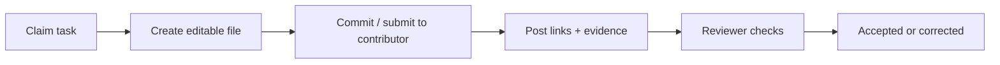

# 📤 How to submit and report subgroup work

This applies to all four subgroups. For exact GitHub click paths and access troubleshooting, start with [How to upload subgroup work](../UPLOAD_GUIDE.md). Public access alone does not grant direct upload rights. **Deadline times use WAT (UTC+1).** A chat update is useful for coordination; the reviewable artifact is the committed file or linked deliverable.

## Step-by-step

1. **Claim:** agree a named owner and reviewer for each output in your subgroup chat. Avoid two people silently editing the same file.
2. **Create:** use the file path specified in your WORKPLAN. Keep source/editable files alongside exported PDF or report. Use fictional data only.
3. **Commit:** if you have GitHub write access, commit directly or open a pull request according to the team lead's workflow. If you do not, send the editable file to the named contributor for upload and verify its GitHub link. Do not assume public visibility grants write access.
4. **Report:** post the format below to your subgroup chat and team lead. Include a file URL, commit SHA, requirement IDs, exact evidence and gaps. Link the relevant entry in [HANDOFFS.md](HANDOFFS.md) and update [CONTRIBUTIONS.md](CONTRIBUTIONS.md).
5. **Review:** reviewer checks the subgroup acceptance gate and records **Accepted**, **Accepted with named gaps**, or **Returned for correction**. An unreviewed file remains Draft. Fixes require a new version/commit and a retest where applicable.
6. **Handoff:** the next group confirms it can open/reproduce the outputs, then records receipt. Do not overwrite prior assessment or test evidence.

## Copy this report into the chat

> **Group / day:**  
> **Owner and reviewers:**  
> **Status:** Draft / Ready for review / Accepted / Blocked  
> **Requirement IDs covered:**  
> **Files and direct GitHub links:**  
> **Commit SHA / version:**  
> **What was completed (specific result):**  
> **How checked (case ID, calculation, command or screenshot):**  
> **Gaps or blockers, owner and due date:**  
> **Next handoff recipient and deadline (WAT):**

## Naming and evidence

Use descriptive filenames and stable IDs such as VEN-001, ASMT-001, Q-AM-01 and T-001; follow the approved data dictionary once issued. Reports must show actual counts and source records. Never mark a vendor claim as accepted evidence without reviewer verification. Do not place real vendor documents, credentials, personal contact data or student IDs in this public repo. For operational use, store assessment files in a restricted organisational system; public GitHub is for the fictional capstone.
