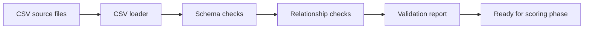

# Phase 1 Python foundation

Use Python 3.10 or later from the repository root. Only the Python standard
library is needed. No package installation, database, SQLite or network is used.
If your system provides `python3` instead of `python`, use `python3` in these commands.

```sh
python -m src.cli --help
python -m src.cli inventory
python -m src.cli validate
python -m src.cli validate --data-dir sample-data
python -m src.cli validate --data-dir sample-data --as-of 2026-11-18
python -m src.cli validate --as-of 2027-01-20 --reports-dir /tmp/phase1-reports
```

The fixed default report date is 2026-11-18. `--as-of` records another valid
YYYY-MM-DD date. It does not change source dates or apply later-phase expiry flags.
Validation returns 0 for a structural pass, 1 for data errors and 2 for command
or report-writing errors. Warnings do not fail validation. Inventory returns
non-zero if source files cannot be read with their required headers.



The final box means structurally ready for later work, not that scoring exists
or that the complete toolkit has passed acceptance.

## Modules

| Module | Purpose |
|---|---|
| `config.py` | Application name/version, repository-relative paths, 12 approved sources, fixed report date and dictionary enumerations |
| `schema.py` | Actual CSV headers, required cell values, primary/composite keys, foreign keys and date fields |
| `loader.py` | Read-only `pathlib` and `csv.DictReader` loading, source inventory and strict date parsing |
| `validation.py` | Required fields, identifiers, duplicates, allowed values, dates, orphan references and pair integrity |
| `cli.py` | Terminal commands, readable issue details and JSON/Markdown validation reports |

`load_table(path)` returns a `Table` with its original headers, raw rows, physical
line numbers, load status and issues. Files use UTF-8. Empty CSV cells stay empty
strings; short rows retain `None` for absent cells and are rejected. Extra cells,
blank/repeated headers, unreadable files, encoding errors and malformed CSV are
reported. Parsed rows remain available even when a later record cannot be read;
in that case loading is marked incomplete. Rows are never silently removed.

`load_source_tables(data_dir)` returns a dictionary keyed by the 12 approved
table names. `validate_tables(data)` returns issues and summary counts. All joins
use keys. Duplicate parents are ambiguous and are never selected by row order.
Do not use rows from a failing validation run for later calculations. Phase 1
does not export accepted/rejected datasets or select a duplicate winner.

## Baseline and header differences

The research baseline is `a06ca9a`. The specification is in
[`data_dictionary.md`](../01-research-and-risk-assessment/data_dictionary.md),
the research methods, workflow, acceptance cases and
[`sample-data/README.md`](../sample-data/README.md). The source CSVs, not the
display headers of the original research question bank, define column names.
Every approved column must exist, including columns with optional cell values.
Additional named columns are preserved and reported as warnings.

| Requested label or minimum | Actual source header / treatment |
|---|---|
| `Domain`, `Wording`, `Answer choices` | `domain`, `question_text`, `response_options` |
| `Weight / severity`, `Critical failure?` | `weight`, `critical_failure_flag` |
| `Evidence artifact and period` | `evidence_description`, with `evidence_required` also present |
| `Reviewer acceptance criteria` | `acceptance_criteria` |
| Evidence `review_date`, `rejection_reason` | No evidence `review_date` column: review time is in audit `timestamp`; covered period is `review_period_end`; rejection explanation is `reason` |
| Minimum business service / link columns | Also preserve `service_owner` and optional `dependency_note` |
| Audit columns | `audit_id`, `timestamp`, `actor_role`, `action`, `table_name`, `record_id`, `note` |

The inventory also labels five `expected_*.csv` files as expected-output, two
`invalid_*_cases.csv` files as negative-test, and `validation_results.txt` as a
reference. They are never passed to source validation. Python fixture helper
scripts and the original research question bank are not source tables.

## What validation means

Checks cover dictionary-required cells, enum values, identifier formats, unique
keys (including response and evidence assessment/question pairs), scalar foreign
keys, evidence-to-response pairs, audit references, vendor ownership of linked
assessments/findings and predecessor version/date relationships. Answer labels
must match the referenced question; the literal `Blank` is a valid unanswered
claim. Weights and option mappings are validated as inputs; no points are calculated.
Evidence-state fields, conditional-decision fields and closed-action dates are
checked as record structure, without creating or transitioning any record.

Every issue has a file, row, field, value, rule, severity, category and correction.
Row numbers are physical CSV lines (last line for a multiline record); header
issues use row 1 and file-level issues use row 0. Duplicate messages name both
lines. Error-category counts count rule violations; duplicate/orphan record
counts count distinct affected rows. A valid table is loaded and has no errors;
other tables may still reference it incorrectly and fail their own checks.

Reports are regenerated in `reports/phase1/` by `validate`. Their execution date
is the actual UTC run date, separate from the chosen report date. The research
fixture validator is preserved and must run separately:

```sh
python3 sample-data/validate_fixture.py
python -m unittest discover -s tests -v
```

## Limits and later work

Phase 1 validates data structure and relationships only. Risk scoring, criticality, decision workflow and Streamlit user pages are implemented in later phases.

No decision authority, workflow transitions, remediation management, overdue
flags, completeness calculations or vendor/management reports are implemented.
Validation reports are the only reports created here. Evidence references are
fictional paths; the files are not fetched or inspected. No real vendor data is allowed.

There are no onboarding, finding-creation or action-creation date columns, so
comparisons requiring them are unavailable. Early action closure is valid;
`closed_date < due_date` is not an error. No missing schema fields are invented.
Evidence pairs are unique in the current fixture and research validator; the
evidence replacement-history rule will need reconciliation with the schema
owner before workflow development. Audit references to composite-key tables
are flagged because no baseline representation is defined. Historical factor
snapshots exist only in an expected-output file, which remains excluded from
production inputs. Structural success is not research-policy or toolkit approval.
