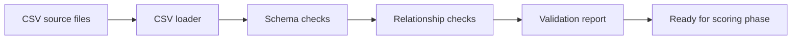

# CSV toolkit foundation

Use Python 3.10 or later from the repository root. The Python engines and
terminal commands use the standard library and read CSV files. The optional
browser interface requires Streamlit. See the [Streamlit guide](../app/README.md).
If your system provides `python3` instead of `python`, use `python3` in these commands.

```sh
python -m src.cli --help
python -m src.cli inventory
python -m src.cli validate
python -m src.cli validate --data-dir sample-data
python -m src.cli validate --data-dir sample-data --as-of 2026-11-18
python -m src.cli validate --as-of 2027-01-20 --reports-dir /tmp/phase1-reports
python -m src.cli semantic-validate --data-dir sample-data --as-of 2026-11-18
python -m src.cli criticality --all --data-dir sample-data
python -m src.cli criticality --assessment-id ASMT-001
python -m src.cli criticality --vendor-id VEN-004
python -m src.cli risk --all --data-dir sample-data --as-of 2026-11-18
python -m src.cli decisions --as-of 2026-11-18
python -m src.cli remediation --as-of 2026-11-18
python -m src.cli management-report --as-of 2026-11-18
python -m src.cli reassess --vendor-id VEN-004
```

The fixed default report date is 2026-11-18. `--as-of` records another valid
YYYY-MM-DD date and is used to classify open corrective actions as overdue in
Phase 2. Neither validation nor calculation changes source dates. Commands return
0 for a pass, 1 for data errors and 2 for command or report-writing errors.



The final box means structurally ready for later work, not that scoring exists
or that the complete toolkit has passed acceptance.

## Modules

| Module | Purpose |
|---|---|
| `config.py` | Application settings, Phase 1 and Phase 2 source lists, report dates and enumerations |
| `schema.py` | Actual CSV headers, required values, primary/composite keys, foreign keys and date fields |
| `loader.py` | Read-only CSV loading, source inventory and strict date parsing |
| `validation.py` | Structural checks and cross-table business rules, including snapshot and history checks |
| `criticality.py` | Explainable assessment-level score, thresholds and approved overrides |
| `cli.py` | Inventory, Phase 1 validation, semantic validation and criticality reports |

`load_table(path)` returns a `Table` with its original headers, raw rows, physical
line numbers, load status and issues. Files use UTF-8. Empty CSV cells stay empty
strings; short rows retain `None` for absent cells and are rejected. Extra cells,
blank/repeated headers, unreadable files, encoding errors and malformed CSV are
reported. Parsed rows remain available even when a later record cannot be read;
in that case loading is marked incomplete. Rows are never silently removed.

`load_source_tables(data_dir)` returns the 12 Phase 1 source tables.
`load_source_tables(data_dir, include_criticality_snapshot=True)` adds the
Phase 2 `assessment_criticality_snapshot` source. `validate_tables(data)` returns
issues, summary counts and overdue actions for its supplied report date. All joins
use keys. Duplicate parents are ambiguous and are never selected by row order.
Do not use a failing validation run for later decisions or reports.

## Baseline and header differences

The approved Phase 1 foundation baseline is `00eb6ee`. The specification is in
[`data_dictionary.md`](../01-research-and-risk-assessment/data_dictionary.md),
the research methods, workflow, acceptance cases and
[`sample-data/README.md`](../sample-data/README.md). The source CSVs, not the
display headers of the original research question bank, define column names.
Every approved column must exist, including columns with optional cell values.
Additional named columns are preserved and reported as warnings.

| Requested label or minimum | Actual source header / treatment |
|---|---|
| `Domain`, `Wording`, `Answer choices` | `domain`, `question_text`, `response_options` |
| `Weight / severity`, `Critical failure?` | `weight`, `critical_failure_flag` |
| `Evidence artifact and period` | `evidence_description`, with `evidence_required` also present |
| `Reviewer acceptance criteria` | `acceptance_criteria` |
| Evidence `review_date`, `rejection_reason` | No evidence `review_date` column: review time is in audit `timestamp`; covered period is `review_period_end`; rejection explanation is `reason` |
| Minimum business service / link columns | Also preserve `service_owner` and optional `dependency_note` |
| Audit columns | `audit_id`, `timestamp`, `actor_role`, `action`, `table_name`, `record_id`, `note` |

The inventory also labels five `expected_*.csv` files as expected-output, two
`invalid_*_cases.csv` files as negative-test, and `validation_results.txt` as a
reference. They are never passed to source validation. Python fixture helper
scripts and the original research question bank are not source tables.

## What validation means

Checks cover dictionary-required cells, enum values, identifier formats, unique
keys (including response and evidence assessment/question pairs), scalar foreign
keys, evidence-to-response pairs, audit references, vendor ownership of linked
assessments/findings and predecessor version/date relationships. Answer labels
must match the referenced question; the literal `Blank` is a valid unanswered
claim. Weights and option mappings are validated as inputs; no points are calculated.
Evidence-state fields, conditional-decision fields and closed-action dates are
checked as record structure, without creating or transitioning any record.

Every issue has a file, row, field, value, rule, severity, category and correction.
Row numbers are physical CSV lines (last line for a multiline record); header
issues use row 1 and file-level issues use row 0. Duplicate messages name both
lines. Error-category counts count rule violations; duplicate/orphan record
counts count distinct affected rows. A valid table is loaded and has no errors;
other tables may still reference it incorrectly and fail their own checks.

Reports are regenerated in `reports/phase1/` by `validate`. Their execution date
is the actual UTC run date, separate from the chosen report date. The research
fixture validator is preserved and must run separately:

```sh
python3 sample-data/validate_fixture.py
python -m unittest discover -s tests -v
```

## Phase 2 criticality and semantic validation

Assessment-level criticality reads four factors only from the stored snapshot row.
The vendor register is never used as a fallback for a missing snapshot field.
The engine adds the four points, maps totals 2–3/4–6/7–9/10–13 to
Low/Medium/High/Critical, then applies the three approved overrides. A result
with invalid or incomplete factor or linked-service inputs is marked
`PROVISIONAL — INCOMPLETE INPUTS` and has no final band.

The historical ASMT-004 snapshot retains the 2026 fixture values separately
from current VEN-004 factors. Expected-output CSVs are never score inputs; the
criticality command reads `expected_criticality.csv` only to compare generated
results after calculation. Sources remain read-only, and Phase 2 reports live in
`reports/phase2/`.

## Limits and later work

Phase 4 adds `decisions`, `remediation`, `reassess`, `management-report` and
`vendor-report`. See [Phase 4 status](../02-toolkit-development/PHASE_4_STATUS.md)
for date handling, data selection and report locations.

Phase 3 adds `python -m src.cli risk` and `python -m src.cli question-scores`.
Both accept assessment and vendor filters, `--as-of` and `--reports-dir`.
See [Phase 3 status](../02-toolkit-development/PHASE_3_STATUS.md) for the
scoring method and fixture verification.

Phase 5 uses the engines in the browser. The interface stores working CSV copies
in session memory and offers downloads for changes and generated reports. SQLite
is unused. Deployment and production access control remain for a later phase.

Phase 2 classifies overdue corrective actions for the supplied report date but
does not run decision or remediation workflows, risk/evidence scoring or
management reporting. Evidence references are fictional paths; files are not
fetched or inspected. No real vendor data is allowed.

There are no onboarding, finding-creation or action-creation date columns, so
comparisons requiring them are unavailable. Early action closure is valid;
`closed_date < due_date` is not an error. No missing schema fields are invented.
Evidence pairs are unique in the current fixture and research validator; the
Evidence items use immutable IDs and audit events, and replacement evidence
must be recorded as a distinct row in a retained assessment version. CSV alone
cannot recover a prior file state that was never preserved; version control and
the supplied audit records provide the available history trail. Audit references
to composite-key tables remain flagged because no baseline representation is
defined. Phase 2 success is not independent policy approval or completion of the
whole toolkit.
