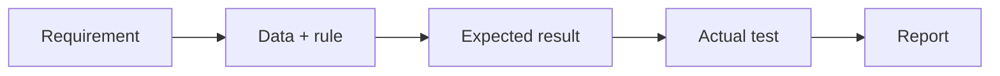

# 🧩 You are in Working Templates

Open [requirements and tests tables](REQUIREMENTS_AND_TESTS.md). Copy the relevant table into your subgroup's actual deliverable, replace every “Pending” with a real value, and retain requirement IDs so research, build, QA and PDF can trace the same behavior.

Templates are starting structures, not completed deliverables. Follow the [submission rules](../governance/SUBMISSION_RULES.md) when asking for review.
